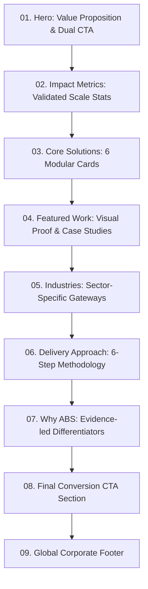
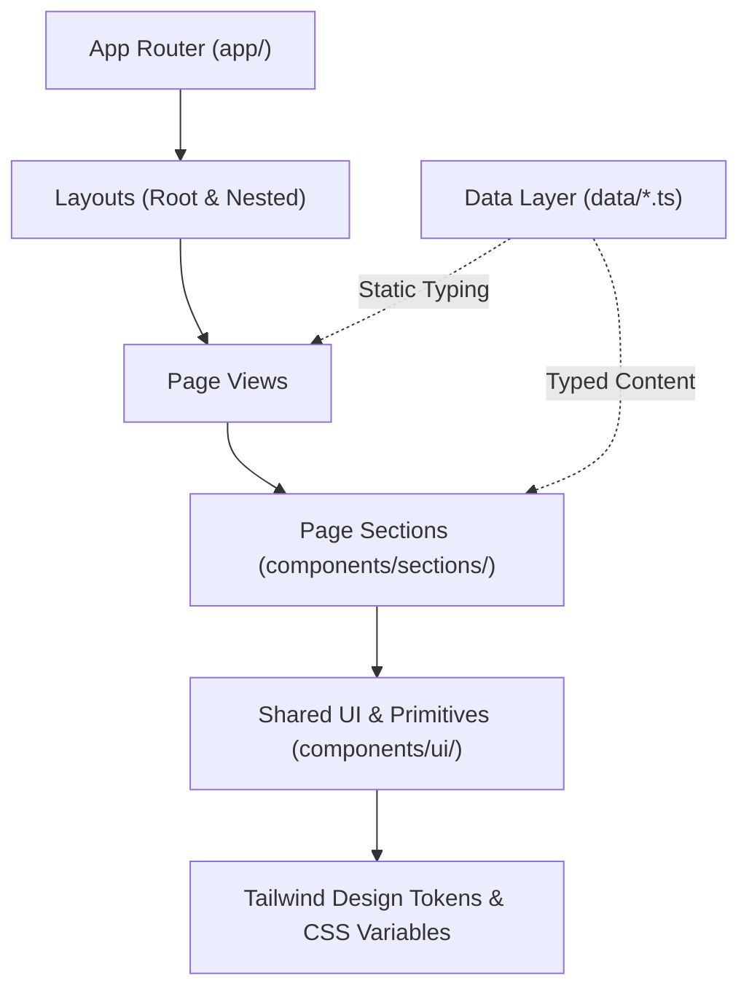

# ABS — Frontend Product Requirements Document (PRD)

> **Document Type:** Corporate Website — UI/UX & Frontend Implementation Specification  
> **Target Audience / Executor:** Antigravity AI Agent & Frontend Engineering Team  
> **Version:** 1.0 • 12 October 2026  
> **Scope:** Frontend experience only (Client-side UI/UX, routing, templates, interactions, accessibility, and SEO). Backend APIs, CMS, database, authentication, and hosting infrastructure are intentionally out of scope.  
> **Source Basis:** `ABS Clientele and Projects_2026.xlsx` and preceding website strategy study. *(Client/project claims require internal approval before public release).*

---

## Table of Contents
1. [Frontend Product Objective](#1-frontend-product-objective)
2. [Recommended Frontend Technology Stack](#2-recommended-frontend-technology-stack)
3. [Frontend Scope](#3-frontend-scope)
4. [Target Users & UX Intent](#4-target-users--ux-intent)
5. [Visual Design Direction](#5-visual-design-direction)
6. [Design Tokens](#6-design-tokens)
7. [Global Navigation](#7-global-navigation)
8. [Homepage — Frontend Specification](#8-homepage--frontend-specification)
9. [Solutions Pages](#9-solutions-pages)
10. [Industries Pages](#10-industries-pages)
11. [Our Work / Case Study Frontend](#11-our-work--case-study-frontend)
12. [About Page](#12-about-page)
13. [Contact Page & Form UX](#13-contact-page--form-ux)
14. [Responsive Design Requirements](#14-responsive-design-requirements)
15. [Animation & Interaction Rules](#15-animation--interaction-rules)
16. [Accessibility Requirements](#16-accessibility-requirements)
17. [SEO Frontend Requirements](#17-seo-frontend-requirements)
18. [Performance Requirements](#18-performance-requirements)
19. [Frontend Architecture](#19-frontend-architecture)
20. [Suggested Frontend Folder Structure](#20-suggested-frontend-folder-structure)
21. [Frontend Content / Data Model](#21-frontend-content--data-model)
22. [Frontend States](#22-frontend-states)
23. [Frontend QA Checklist](#23-frontend-qa-checklist)
24. [Frontend Definition of Done (DoD)](#24-frontend-definition-of-done-dod)
25. [Antigravity — Master Frontend Instruction](#25-antigravity--master-frontend-instruction)
26. [Client Confirmation Before Final UI](#26-client-confirmation-before-final-ui)

---

## 1. Frontend Product Objective

Build a premium, modern, responsive corporate website that positions **ABS** as a high-reliability digital transformation and enterprise solutions partner with demonstrated experience in:
- Government & Public Sector
- Education & Admissions
- Examination Authorities
- Recruitment & Workforce Administration
- Workflow Automation
- MIS & Data Analytics Systems

### Key Objectives
- **First Viewport Impact:** Clearly communicate the ABS core value proposition within the first viewport.
- **Narrative Hierarchy:** Establish a clear visual progression: `Business Problem → Solution → Evidence / Proof → Enquiry`.
- **Proof-Driven Portfolio:** Transform the project portfolio into compelling, data-backed visual case studies.
- **Scalable Component System:** Provide reusable page templates and modular UI components so new projects, solutions, and industries can be added without UI redesigns.
- **High Performance & Accessibility:** Deliver a blazingly fast, accessible (WCAG 2.2 AA), and SEO-optimized frontend.
- **Avoid Anti-Patterns:** Strictly avoid the visual language of a generic IT outsourcing agency or an outdated, cluttered government portal.

> **Core UX Principle:** **Evidence over decoration.** Visual polish must support trust, clarity, and proof — never compete with the content.

---

## 2. Recommended Frontend Technology Stack

| Layer | Technology | Requirement |
| :--- | :--- | :--- |
| **Framework** | Next.js 15+ | App Router architecture; choose current stable version compatible with project environment. |
| **UI Runtime** | React 19+ | Component-driven UI architecture. |
| **Language** | TypeScript | Strict typing (`strict: true`); avoid untyped JavaScript for new components. |
| **Styling** | Tailwind CSS | Semantic design tokens and utilities; avoid uncontrolled one-off ad-hoc styles. |
| **UI Primitives** | shadcn/ui | Radix-based accessible primitives; customized strictly to the ABS design system. |
| **Animation** | Framer Motion | Purposeful transitions, scroll reveals, and micro-interactions; keep motion restrained. |
| **Icons** | Lucide React | Clean, consistent outline icon family. |
| **Forms** | React Hook Form + Zod | Strict schema validation, accessible error announcements, and resilient form states. |
| **Typography** | Inter / Manrope | Approved clean sans-serif; self-hosted and font-display optimized. |
| **Images** | Next/Image | Responsive sizing, automatic WebP/AVIF delivery, and lazy loading. |
| **Version Control** | Git + GitHub | Clean feature branches with conventional, reviewable commits. |
| **Deployment Target** | Vercel (preferred) | Or approved customer infrastructure if already specified. |

> **Repository Inspection Rule:** Antigravity must inspect the existing repository before installing or replacing frameworks. If an existing frontend already uses a compatible stack, preserve and build upon it where practical rather than rebuilding unnecessarily.

---

## 3. Frontend Scope

| In Scope (Frontend PRD) | Out of Scope for this PRD |
| :--- | :--- |
| Responsive corporate website UI/UX | Database design & schema migrations |
| Client-side navigation, layouts, and routing | CMS implementation & backend admin |
| Reusable page templates & component library | Admin dashboard & role management |
| Semantic design system & design tokens | Backend user authentication / session handling |
| Fluid animations & micro-interactions | Backend API endpoints & business logic services |
| Form UI, inline validation & client UX states | Mail server / SMTP / delivery pipeline |
| Technical SEO metadata & JSON-LD structures | Production cloud infrastructure & DevOps setup |
| WCAG 2.2 AA accessibility implementation | Live CRM integration implementation |
| Loading, error, empty, and 404 UI states | Payment gateway & billing integrations |

---

## 4. Target Users & UX Intent

| User Persona | Frontend UX Requirement |
| :--- | :--- |
| **Government / Institutional Decision-Maker** | Immediately communicate organizational reliability, mission-critical scale, domain expertise, and validated case studies. |
| **University / Education Authority** | Quick discovery of admissions management, examination conduct, student lifecycle, and institutional governance solutions. |
| **Recruitment / Examination Authority** | Instantly find candidate registration, application processing, merit listing, seat allocation, and examination workflow capabilities. |
| **Enterprise Buyer** | Clearly evaluate workflow automation, custom enterprise application development, and MIS/reporting capabilities. |
| **Technical Evaluator / Auditor** | Access structured capabilities, verified project evidence, compliance notes, and architectural summaries where approved. |

---

## 5. Visual Design Direction

- **Overall Character:** Premium enterprise technology combined with institutional trust, authority, and confidence.
- **Color Foundation:** Deep navy/slate blue foundation layered with crisp white and light cool-gray (`#F4F7FB`) surface cards.
- **Restrained Accent:** Precision teal / cyan used sparingly for visual focal points, interactive highlights, and data visualizations.
- **Typography:** Strong modern sans-serif typography with an authoritative type scale and generous line-height for effortless readability.
- **Whitespace & Structure:** Generous whitespace and strong typographic hierarchy to build confidence, avoiding cluttered visual noise.
- **Imagery & Visual Assets:** Custom workflow diagrams, abstract vector data flows, and approved product interface screenshots instead of generic office stock photography.
- **Selective Glassmorphism:** Subtle, translucent layered glass effects permitted only on floating headers or hero accents; must never compromise text contrast.
- **Depth & Elevation:** Restrained border strokes, modest border radii, and soft low-opacity ambient shadows rather than harsh drop shadows or neon glow.
- **Restrained Motion:** Motion must communicate system state, relationships, and progression; never exist merely for visual spectacle.

---

## 6. Design Tokens

| Token Group | Initial Direction | Application Rule |
| :--- | :--- | :--- |
| **Color / Background** | `#FFFFFF`, `#F4F7FB`, Deep Navy (`#0A1128` / `#0F172A`) | Define semantic design tokens (`bg-background`, `bg-surface`, `bg-muted`); avoid hard-coding hex values. |
| **Primary** | Deep Navy / Enterprise Blue | Primary brand identity, navigation bar, major section headings, and dominant surfaces. |
| **Accent** | Restrained Teal / Cyan | Targeted highlights, key callouts, data indicators, and interactive focus states. |
| **Text** | Near-black (`#0F172A`) & Muted Cool Slate (`#475569`) | Maintain strict WCAG AA contrast (≥ 4.5:1 for body copy, ≥ 3:1 for large text). |
| **Spacing Scale** | 4px base modular scale | Use standard steps: `4, 8, 12, 16, 24, 32, 48, 64, 96, 128px`. |
| **Border Radius** | Small-to-Medium (`rounded-md`, `rounded-lg`) | Avoid excessive bubble/pill shapes except for discrete status badges and pill action buttons. |
| **Shadows** | Soft, diffused low-opacity ambient shadows | Use subtle multi-layered elevation; avoid harsh, saturated drop shadows. |
| **Container** | Max width `1200px` – `1280px` | Allow full-width hero backgrounds while constraining text lines for optimal reading length. |

---

## 7. Global Navigation

### Desktop Header
- **Layout:** `ABS Logo` → `Solutions` (dropdown) → `Industries` (dropdown) → `Our Work` → `Capabilities` → `About` → `Insights` *(optional / Phase 2)* → `Contact CTA`.
- **Behavior:**
  - Concise primary navigation; use structured mega menus only if they measurably enhance discoverability.
  - Sticky header with subtle scroll blur/shrink effect that never covers or obscures content.
  - Accessible dropdown menus with proper ARIA attributes (`aria-expanded`, `aria-haspopup`).

### Mobile Navigation
- **Structure:** Clean header with ABS Logo, mobile sheet trigger (hamburger), and direct high-priority Contact action.
- **Experience:** Full-screen or slide-out drawer featuring smooth transitions, focus traps, and keyboard dismiss (`Escape`).

### Supplemental Navigation
- **Breadcrumbs:** Provided on all Solution, Industry, and Case Study detail pages for clear spatial orientation.
- **Footer:** Mirrors the full site information architecture, accompanied by direct contact coordinates, legal links, and an enquiry callout.
- **Accessibility:** Full keyboard operability (Tab order) with clear, high-contrast `:focus-visible` outlines.

---

## 8. Homepage — Frontend Specification



| # | Section | Frontend Behavior & Content Composition |
| :-: | :--- | :--- |
| **01** | **Hero** | Full-width premium composition. Authoritative headline, concise value proposition, primary action (*Explore Solutions* / *Request Consultation*), secondary action (*View Case Studies*). Optional interactive abstract data flow / network canvas. No heavy auto-playing video by default. |
| **02** | **Impact Metrics** | Accessible animated count-up triggers once when entering viewport. Display up to 4 approved metrics (e.g., Millions of applicants processed, High-concurrency operations, Zero downtime). Each stat links to its corresponding case study. |
| **03** | **Solutions** | Six distinct interactive solution cards. Hover/focus states reveal supporting capabilities without breaking layout. Fully functional and readable without mouse hover. |
| **04** | **Featured Work** | 3–4 featured project highlights featuring category badge, project title, verified scale/proof metric, client context, and a deep-link CTA to the full case study. |
| **05** | **Industries** | Sector cards or horizontal tabs organizing government, education, exam bodies, and enterprise. Clicking routes to industry detail views. |
| **06** | **Delivery Approach** | Visual 6-step lifecycle pipeline: `Discover → Architect → Build → Validate → Deploy → Improve`. Clear step indicators and descriptive subtitles. |
| **07** | **Why ABS** | Evidence-led differentiator grid highlighting institutional trust, compliance, security, high concurrency, and domain expertise. No generic marketing fluff. |
| **08** | **Final CTA** | High-contrast conversion banner with direct invitation to discuss transformation requirements and launch contact flow. |
| **09** | **Footer** | Complete link directory, company information, copyright notice, legal/privacy links, and approved social channels. |

---

## 9. Solutions Pages

Every solution page must follow a disciplined, proof-driven narrative that moves from problem context directly into operational proof. Generic service brochures are prohibited.

### Required Content Hierarchy per Solution
1. **Hero:** Problem context, solution title, and high-level value statement.
2. **Problem Statement:** Detailed breakdown of operational bottlenecks and domain challenges.
3. **Core Capabilities:** Structured grid of modular capabilities and system features.
4. **Interactive Workflow Diagram:** Visual step-by-step diagram showing data and process flow.
5. **Relevant Projects & Proof:** Direct links to real-world deployments and validated client case studies.
6. **Solution CTA:** Dedicated consultation inquiry trigger.

### The Six Primary Solution Categories
1. **Digital Governance:** Large-scale institutional automation, citizen services, departmental portals, and audit-compliant workflows.
2. **Education & Admissions:** Centralized counseling, university seat allocation, student enrollment, and institutional MIS systems.
3. **Examination Management:** High-stakes exam registration, center allocation, hall ticket generation, secure result computation, and merit declaration.
4. **Recruitment Management:** End-to-end recruitment pipelines, multi-tier eligibility screening, reservation compliance, scoring, and appointment allocation.
5. **Workflow Automation:** Complex process digitization, multi-level hierarchy approvals, SLA tracking, task escalations, and audit trails.
6. **MIS & Data Analytics:** High-volume data reconciliation, executive dashboards, predictive reporting, and statistical decision-support platforms.

---

## 10. Industries Pages

Industry pages act as a **contextual discovery layer** mapping high-level sectoral challenges directly into ABS solutions and proof points:
$$\text{Sector Challenge} \longrightarrow \text{Targeted Solutions} \longrightarrow \text{Proven Deployments} \longrightarrow \text{Enquiry}$$

### Key Industry Verticals
- **Government & Public Sector:** High-compliance state portals, regulatory frameworks, public distribution, and welfare delivery.
- **Higher Education:** Universities, agricultural universities, and technical boards managing end-to-end academic lifecycles.
- **Examination Authorities:** State and central examination agencies requiring bulletproof security, concurrency, and audit logs.
- **Recruitment & Workforce Administration:** State commissions, teacher recruitment authorities, and public sector undertakings.
- **Skill & Vocational Education:** Technical vocational councils, apprenticeship programs, and certification tracking.

---

## 11. Our Work / Case Study Frontend

The case study template is the central proof engine of the corporate site. It must use a reusable, data-driven structure.

### Case Study Template Structure
| Section Component | Requirement & Specification |
| :--- | :--- |
| **Project Hero** | Project title, client/authority name, sector tag, key outcome badge, verified visual/mockup. |
| **Context** | Concise institutional background, statutory mandate, and operational scale. |
| **Challenge** | 3–5 bulleted verified operational pain points (e.g., paper bottlenecks, high latency, fraud risk). |
| **Solution** | Complete technical and process intervention delivered by ABS. |
| **Workflow Diagram** | Interactive or animated process flow diagram (must maintain full accessibility in static fallback mode). |
| **Scale Metrics** | Approved numerical metrics with explicit timeline/concurrency context (e.g., `1.2M+ Candidates`, `400K Concurrent Users`). |
| **Measurable Outcomes** | Strictly approved, verified outcomes (e.g., `90% reduction in processing time`); never fabricate figures. |
| **Screenshots / Visuals** | Approved product interface captures with sensitive personal/institutional data scrubbed or anonymized. |
| **Related Work** | 2–3 contextual cross-links to related projects or parent solution categories. |
| **Conversion CTA** | Direct action: *"Discuss a similar project with our solution architects"*. |

### Priority Case Study Candidates
- **State CET Cell** (Centralized Entrance Test & Admission Allocation System)
- **PAVITRA Portal** (Statewide School Teacher Recruitment & Verification System)
- **MCAER** (Maharashtra Council of Agricultural Education and Research Admissions)
- **Directorate of Higher Education (DHE)** (Grant-In-Aid Assessment & Disbursal Automation)
- **MPKV / VNMKV** (Comprehensive Agricultural University Student Lifecycle Systems)
- **State Statistical & MIS Portals** (Enterprise Data Reconciliation & Reporting)

> **Content Guardrail:** Content for portfolio items must be cross-verified against `ABS Clientele and Projects_2026.xlsx`. Unconfirmed metrics must be flagged as `[TO BE CONFIRMED]`.

---

## 12. About Page

- **Company Overview & Positioning:** Position ABS as an engineering powerhouse and long-term institutional technology partner.
- **Core Domain Expertise:** Highlight longevity, government and university partnerships, and mission-critical execution.
- **Delivery Philosophy:** Detail engineering rigor, security-first mindsets, and transparent implementation methodologies.
- **Trust Indicators & Credentials:** Showcase client sectors, certifications (e.g., ISO, CMMI, security audits where approved), and operational milestones.
- **Leadership & Governance:** Dedicated team and leadership profiles *(display only upon receipt of approved biographies and photos)*.
- **Conversion CTA:** Direct call to engage ABS for strategic consultations.

---

## 13. Contact Page & Form UX

### Enquiry Form Specification
- **Form Fields:**
  - Full Name *(Required, text)*
  - Organization / Department *(Required, text)*
  - Work Email *(Required, email format)*
  - Phone Number *(Optional, international phone validation)*
  - Area of Interest *(Required, select: Digital Governance, Admissions, Examinations, Recruitment, Automation, MIS, Other)*
  - Project Scope / Requirement Summary *(Required, textarea, min 20 characters)*
  - Data Privacy / Consent Checkbox *(Required)*
- **Client-Side UX & Validation:**
  - Built with React Hook Form + Zod schema validation.
  - Inline error messages associated via `aria-describedby` with real-time feedback on blur/submit.
  - Accessible, explicit `<label>` elements; never substitute HTML placeholders for labels.
  - Submitting state disables the submit button and shows an accessible loading spinner to prevent duplicate dispatches.
  - Success state clearly details next steps: *"Thank you. An enterprise solution architect will review your requirement and respond within 1 business day."*
- **Security & Privacy:**
  - Never expose API keys, internal credentials, or secret webhook URLs in client-side bundles.
  - Display verified physical corporate addresses, contact emails, and office locations.

---

## 14. Responsive Design Requirements

| Breakpoint Range | Target Device Class | Responsive Layout Priority |
| :--- | :--- | :--- |
| **360px – 430px** | Mobile Phones | Zero horizontal overflow; touch-friendly tap targets (≥ 44×44px); single-column card stacking; thumb-accessible hamburger menu. |
| **768px** | Tablets | 2-column card reflow; preserved visual hierarchy; compact spacing scales. |
| **1024px** | Small Laptops / Tablets Landscape | Smooth transition from mobile drawer to full desktop navigation; multi-column grid layouts. |
| **1280px** | Desktop Standard | Primary container constraint (`max-w-7xl` / `1280px`); balanced multi-column grids and hero layouts. |
| **1440px+** | Large / Ultra-wide Displays | Generous whitespace scaling; body typography constrained to avoid excessively long line lengths. |

- Avoid raw downscaling; deliberately reflow content across layouts.
- Tables and wide matrices must stack into mobile cards or provide smooth, touch-friendly horizontal scroll containers.

---

## 15. Animation & Interaction Rules

- **Framework:** Framer Motion with hardware-accelerated properties (`transform`, `opacity`).
- **Section Reveals:** Restrained vertical translate (`y: 16 → 0`) and opacity fade (`opacity: 0 → 1`) on scroll entry.
- **Card Hover States:** Gentle upward elevation (`y: -4px`) with soft shadow expansion and border accent illumination.
- **Metric Count-ups:** Smooth counter animation triggered once via IntersectionObserver when entering viewport.
- **Process & Workflow Diagrams:** Progressive node/path illumination to guide sequential comprehension.
- **Buttons & Controls:** Fast, immediate feedback on `:hover`, `:active`, and `:focus-visible`.
- **Accessibility & Motion Preference:** Must strictly respect `prefers-reduced-motion: reduce`, providing instantaneous static rendering with zero motion.
- **Performance Rule:** Prohibit scroll-jacking, heavy continuous loops, or layout-thrashing animations.

---

## 16. Accessibility Requirements (WCAG 2.2 AA)

- **Semantic Landmarks:** Full structure using `<header>`, `<nav>`, `<main>`, `<section>`, `<article>`, and `<footer>`.
- **Heading Order:** Exactly one meaningful `<h1>` per page, followed by strict hierarchical `<h2>` and `<h3>` tags without skipping levels.
- **Keyboard Navigation:** Every interactive element must be fully reachable and operable via keyboard Tab/Enter/Space navigation.
- **Focus Rings:** Distinct, high-contrast `:focus-visible` styling on all buttons, links, and form inputs.
- **Mobile Menu Accessibility:** Focus trapped inside mobile drawer when opened; restored to trigger upon close; supports `Escape` key dismissal.
- **Images & Media:** Descriptive `alt` attributes on meaningful images; empty `alt=""` and `aria-hidden="true"` on decorative icons and vector flourishes.
- **Color Independence:** Status indicators, form validations, and links must never rely solely on color to convey information (pair with icons and text).
- **Touch Target Sizing:** Minimum clickable/tappable area of 44×44 CSS pixels for all touch targets.

---

## 17. SEO Frontend Requirements

- **Route Metadata:** Dynamic, unique `<title>` and `<meta name="description">` tags configured for every route via Next.js Metadata API.
- **Canonical URLs:** Explicit canonical tags defined per page to avoid duplicate indexing.
- **Open Graph & Twitter Cards:** Complete `og:title`, `og:description`, `og:image`, `og:type`, and `twitter:card` tags.
- **Search Engine Discovery:** Valid XML sitemap (`/sitemap.xml`) and robots configuration (`/robots.txt`).
- **Structured Data (JSON-LD):**
  - `Organization` schema on root layout.
  - `WebSite` with search potential.
  - `BreadcrumbList` on deep hierarchy pages.
  - `Article` / `CaseStudy` schemas on portfolio case studies.
- **Content Integrity:** Critical SEO content, solution overviews, and case study details must be server-rendered, not hidden behind client-only toggles.

---

## 18. Performance Requirements

| Metric / Area | Frontend Target | Strategy |
| :--- | :--- | :--- |
| **Core Web Vitals** | Green / Good scores across Mobile & Desktop | Lighthouse score ≥ 90 in Performance, Accessibility, Best Practices, and SEO. |
| **LCP (Largest Contentful Paint)** | ≤ 2.5s | Optimize hero image rendering, preload primary font subsets, avoid heavy hero videos. |
| **CLS (Cumulative Layout Shift)** | ≤ 0.1 | Explicit `width` and `height` on all media/images; reserve layout space for dynamic elements. |
| **INP (Interaction to Next Paint)** | ≤ 200ms | Keep event handlers lightweight; offload non-critical client work. |
| **Images** | Next/Image with WebP/AVIF | Modern compression formats, responsive `sizes` attributes, and lazy loading for off-screen images. |
| **Fonts** | Inter / Manrope | Preload only critical font weights using `next/font` with zero layout shift (`font-display: swap`). |
| **Client Bundles** | Minimal JS footprint | Maximize Server Components; isolate `'use client'` only to interactive leaf components. |

---

## 19. Frontend Architecture



- **Separation of Concerns:** Keep route-level page wrappers separate from presentation section blocks and UI primitives.
- **Data-Driven Composition:** Content for solutions, industries, and case studies lives in typed data structures (`data/*.ts`) to prevent duplicated JSX.
- **Single Source of Truth:** Centralize navigation links, footer directories, and CTA hierarchies in a shared config.
- **Boundary States:** Provide robust fallback boundaries: `loading.tsx`, `error.tsx`, and `not-found.tsx` for all route segments.

---

## 20. Suggested Frontend Folder Structure

```
├── app/
│   ├── layout.tsx                  # Root layout (Metadata, Fonts, Theme, Global Nav & Footer)
│   ├── page.tsx                    # Homepage
│   ├── loading.tsx                 # Root loading state
│   ├── not-found.tsx               # Custom 404 page
│   ├── error.tsx                   # Error boundary
│   ├── about/
│   │   └── page.tsx                # About page
│   ├── solutions/
│   │   ├── page.tsx                # Solutions listing
│   │   └── [slug]/
│   │       └── page.tsx            # Dynamic solution detail page
│   ├── industries/
│   │   ├── page.tsx                # Industries listing
│   │   └── [slug]/
│   │       └── page.tsx            # Dynamic industry detail page
│   ├── work/
│   │   ├── page.tsx                # Case studies / Portfolio listing
│   │   └── [slug]/
│   │       └── page.tsx            # Dynamic case study detail page
│   ├── contact/
│   │   └── page.tsx                # Contact page with interactive form
│   ├── sitemap.ts                  # Dynamic XML sitemap generator
│   └── robots.ts                   # Search crawler directives
├── components/
│   ├── ui/                         # Base primitives (Button, Card, Input, Badge, Dialog, etc.)
│   ├── navigation/                 # Header, DesktopNav, MobileNav, Footer, Breadcrumbs
│   ├── sections/                   # Modular homepage and landing sections
│   │   ├── HeroSection.tsx
│   │   ├── MetricsSection.tsx
│   │   ├── SolutionsGrid.tsx
│   │   ├── FeaturedWork.tsx
│   │   ├── DeliveryApproach.tsx
│   │   └── WhyABS.tsx
│   └── case-study/                 # Case study specific templates (WorkflowDiagram, OutcomeCard, etc.)
├── data/                           # Typed mock & content models (pre-CMS)
│   ├── solutions.ts
│   ├── industries.ts
│   ├── case-studies.ts
│   └── navigation.ts
├── lib/
│   ├── utils.ts                    # Utility functions (cn helper, formatting)
│   ├── validations.ts              # Zod validation schemas (Contact form)
│   └── seo.ts                      # JSON-LD and metadata generators
├── types/
│   └── index.ts                    # Shared TypeScript interfaces & types
├── styles/
│   └── globals.css                 # Tailwind directives, CSS variables & design tokens
└── public/
    ├── brand/                      # ABS logos, emblems, favicons
    └── images/                     # Approved case study diagrams and visuals
```

---

## 21. Frontend Content / Data Model

```typescript
// types/index.ts

export interface NavigationItem {
  label: string;
  href: string;
  children?: NavigationItem[];
  visibility?: 'all' | 'desktop' | 'mobile';
}

export interface CTAConfig {
  label: string;
  href: string;
  variant?: 'primary' | 'secondary' | 'outline';
  trackingKey?: string;
}

export interface Solution {
  slug: string;
  title: string;
  shortDescription: string;
  heroCopy: string;
  capabilities: string[];
  workflowSteps?: Array<{
    title: string;
    description: string;
  }>;
  relatedProjects: string[]; // Project slugs
  cta: CTAConfig;
}

export interface Industry {
  slug: string;
  title: string;
  description: string;
  needs: string[];
  solutions: string[]; // Solution slugs
  projects: string[];  // Project slugs
}

export interface ProjectCaseStudy {
  slug: string;
  title: string;
  client: string;
  sector: string;
  summary: string;
  challenge: string[];
  solution: string[];
  workflow: Array<{
    step: number;
    title: string;
    detail: string;
  }>;
  metrics: Array<{
    value: string;
    label: string;
    context: string;
  }>;
  outcomes: string[];
  media: Array<{
    url: string;
    caption: string;
    type: 'image' | 'diagram';
  }>;
  approvalStatus: 'approved' | 'pending_verification';
}

export interface SEOMetadata {
  title: string;
  description: string;
  canonical?: string;
  ogImage?: string;
}
```

---

## 22. Frontend States

Every UI component and page template must explicitly account for all states:
1. **Default:** Clean, baseline interactive presentation.
2. **Hover:** Clear cursor indicator and subtle transformation (`y: -2px`, color accent).
3. **Focus:** Unambiguous `:focus-visible` outline for keyboard navigation.
4. **Active:** Pressed feedback state (`scale: 0.98`).
5. **Disabled:** Visual muted opacity and `pointer-events-none` for inoperable controls.
6. **Loading / Skeleton:** Fluid skeleton cards for data fetching and route transitions.
7. **Empty State:** High-quality empty feedback when no portfolio items match filter criteria.
8. **Error State:** User-friendly alert banner with retry actions.
9. **Not-Found (404):** Polished 404 page with navigation redirects back to core solutions.
10. **Mobile Navigation:** Seamlessly animated open and closed overlay drawer states.
11. **Reduced Motion:** Automatic CSS and Framer Motion suppression when prefers-reduced-motion is active.

---

## 23. Frontend QA Checklist

| QA Area | Acceptance Criteria |
| :--- | :--- |
| **Visual Fidelity** | Zero layout clipping, zero horizontal overflow, consistent spacing across 360px–1440px+. |
| **Responsive Design** | Fluid reflow on mobile, tablet, laptop, and ultra-wide screens. |
| **Navigation & Links** | All internal links, external links, anchor scrolls, and CTAs route accurately without 404s. |
| **Accessibility (a11y)**| Full keyboard navigation passed; WCAG contrast ratios satisfied; screen reader labels present. |
| **Performance** | Next/Image responsive sizes configured; font preloading active; no unoptimized assets. |
| **SEO Verification** | Unique titles, descriptions, Open Graph cards, canonical tags, and structured JSON-LD verified. |
| **Forms & Validation** | Zod validation working; inline errors legible; submission loading prevents double clicks. |
| **Cross-Browser** | Tested and verified on latest Google Chrome, Microsoft Edge, Mozilla Firefox, and Apple Safari. |
| **Code Quality** | Strict TypeScript compilation passes with zero errors; no `any` types; clean ESLint check. |
| **Content Integrity** | No `Lorem Ipsum`, placeholder claims, or unapproved statistics present in production code. |

---

## 24. Frontend Definition of Done (DoD)

- [ ] Next.js 15+ / React 19+ / TypeScript frontend builds successfully from a clean install (`npm run build`).
- [ ] Centralized design tokens and reusable UI component primitives are implemented.
- [ ] Homepage and all core page templates are fully responsive across all breakpoints (360px – 1440px+).
- [ ] All 6 core solution categories possess dedicated, high-fidelity frontend templates.
- [ ] Industry vertical and case study detail templates are implemented with data-driven models.
- [ ] Approved client portfolio content is integrated accurately without invented marketing claims.
- [ ] WCAG 2.2 AA accessibility baseline is fully verified (keyboard nav, landmarks, focus rings, contrast).
- [ ] Technical SEO structure (metadata, sitemap, robots, Open Graph, JSON-LD) is implemented.
- [ ] Route loading (`loading.tsx`), error boundaries (`error.tsx`), and 404 (`not-found.tsx`) states are active.
- [ ] Interactive contact form features complete schema validation, loading state, and success feedback.
- [ ] Animations adhere to `prefers-reduced-motion` preferences.
- [ ] Performance benchmarks meet Core Web Vitals targets with optimized bundle size.
- [ ] Clear README documentation is provided with build, test, and run instructions.

---

## 25. Antigravity — Master Frontend Instruction

Treat this PRD as the frontend source of truth.

- **GOAL:** Build a premium, modern, responsive corporate frontend positioning ABS as a digital transformation and enterprise solutions partner specializing in government, education, examinations, recruitment, workflow automation, and MIS/data platforms.
- **STACK:** Next.js 15+ with App Router, React 19+, TypeScript, Tailwind CSS, shadcn/ui where useful, Framer Motion for restrained animation, Lucide React icons, React Hook Form + Zod for forms, Next/Image for media, Git/GitHub. Vercel is preferred for deployment unless the existing project specifies another approved platform.
- **FIRST ACTION:** Inspect the existing repository before changing anything. Identify framework, package manager, current routes, components, assets, and deployment configuration. Do not destructively replace an existing compatible frontend.
- **DESIGN:** Use premium enterprise technology aesthetics: deep navy/blue, white/light cool-gray surfaces, restrained teal/cyan accents, strong modern typography, generous whitespace, subtle depth, and purposeful motion. Avoid generic IT agency visuals, excessive neon, excessive glassmorphism, heavy 3D, and generic office stock imagery.
- **PAGES:** Home, About, Solutions listing/detail, Industries listing/detail, Our Work, Case Study detail, Capabilities, optional Insights, Contact.
- **SOLUTIONS:** Digital Governance; Education & Admissions; Examination Management; Recruitment Management; Workflow Automation; MIS & Data Analytics.
- **HOMEPAGE ORDER:** Hero → Impact Metrics → Solutions → Featured Work → Industries → Delivery Approach → Why ABS → Final CTA → Footer.
- **CASE STUDIES:** Create a reusable template with context, challenge, solution, workflow, verified scale, verified outcomes, approved screenshots/media, related solutions, and CTA.
- **RESPONSIVE:** Design intentionally for 360px mobile through 1440px+ desktop. Do not simply shrink desktop layouts.
- **ACCESSIBILITY:** Target WCAG 2.2 AA-oriented UX. Semantic HTML, keyboard access, visible focus, accessible forms, alt text, sufficient contrast, and `prefers-reduced-motion`.
- **SEO:** Route-level metadata, semantic headings, canonical URLs, sitemap/robots structure, Open Graph, and appropriate JSON-LD.
- **PERFORMANCE:** Use Server Components where appropriate, minimize client components, optimize images/fonts, avoid scroll-jacking and expensive animation, and review Core Web Vitals.
- **CONTENT SAFETY:** Never invent client names, logos, statistics, technologies, certifications, outcomes, or testimonials. Use approved source data only. The supplied `ABS Clientele and Projects_2026.xlsx` is the source for portfolio information. Mark unverified facts as `[TO BE CONFIRMED]` internally.
- **ARCHITECTURE:** Use reusable components and data-driven templates. Keep navigation, tokens, project cards, solution cards, metrics, CTA, and typography centralized. Provide loading, error, and not-found states.
- **DELIVERABLE:** Production-ready frontend, responsive layouts, reusable component system, structured content/data model, SEO/accessibility implementation, QA checklist, and run/build instructions.
- **BACKEND EXCLUSION:** Do not implement backend, database, CMS, or authentication as part of this frontend PRD unless the existing frontend requires a temporary mock/data layer. Keep integration boundaries clean for a later backend/CMS phase.

---

## 26. Client Confirmation Before Final UI

Before locking the final production UI, confirm the following items with the ABS client leadership:
1. **Official Brand Assets:** Official high-resolution ABS logo (SVG/vector) and exact primary/secondary brand hex codes.
2. **Legal Details:** Exact registered legal company name, registration number, and copyright wording.
3. **Client Approvals:** Confirmation of which specific government and university client names and emblems can be displayed publicly.
4. **Public Metrics:** Explicit clearance on which project scale metrics (e.g., student counts, transaction numbers) can be shown on public pages.
5. **UI Screenshots:** Approved software screenshots with institutional or candidate PII masked/redacted.
6. **Contact Coordinates:** Approved official enterprise contact email addresses, phone numbers, and physical office addresses.
7. **Insights / Blog Rollout:** Confirmation on whether the Insights/Blog section should launch in Phase 1 or Phase 2.
8. **Delivery Methodology:** Final wording and terminology for the 6-step delivery methodology.
9. **Credentials & Accreditations:** Validated list of official certifications, ISO standards, and empanelments.

---

*End of Frontend Product Requirements Document • Version 1.0*
